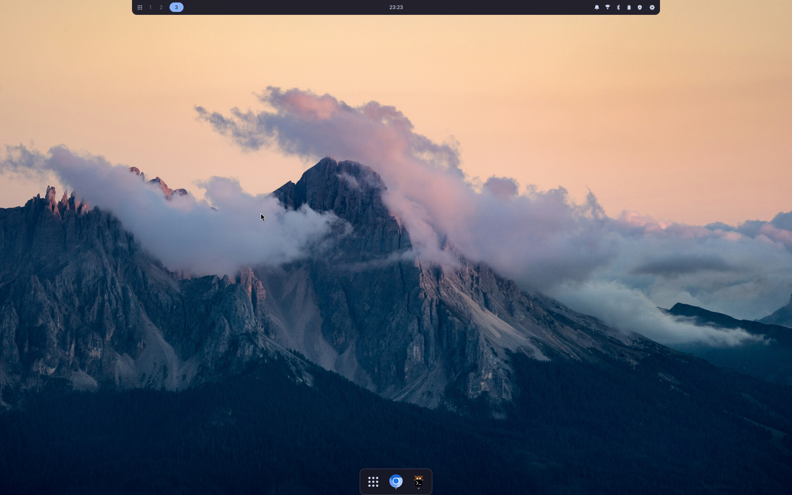

# kumaOS

[](https://github.com/Letdown2491/kumaos/actions/workflows/ci.yml)

**Your system is one file.**

kumaOS is a Linux distribution you describe in a single TOML file. The
file says what the machine should have: a desktop, some applications, a
few command line tools, its services, snapshots and backups. `kuma`
turns that description into a complete system image, and installing a
machine means applying the file. So does every update after it.

kumaOS is a layer over
[Fedora bootc](https://docs.fedoraproject.org/en-US/bootc/). Fedora
supplies the packages and the kernel. kuma decides what goes into the
image and keeps the running machine matching your file. New to the
vocabulary? [The glossary](docs/glossary.md) defines each term in a line.

## Principles

1. **Simple.** The schema stays small and boring. Every field is a
   promise kept forever, so new ones have to earn their place.
2. **Atomic.** Applying a declaration never mutates the running system:
   build, switch, reboot. An update lands completely or not at all.
   Rollback is always available, and automatic when the new image can't
   boot to a healthy system.
3. **Local-first.** `kuma build` needs nothing but podman. No forge
   account, no CI, no registry. All optional, later.
4. **Self-describing.** Every command ends at the legal next commands,
   and the image carries the declaration it was built from. Agents get
   the same surface in `--json`, promised permanent in
   [the contract](docs/contract.md).



## The desktop

`desktop = "niri"` installs the [niri](https://github.com/YaLTeu/niri)
compositor and **kumaUI**, a shell written for it: a top bar, an app
launcher, drawer panels, a lock screen, and the desktop's own file
manager, terminal and system monitor. The shell knows about kuma. Its
Kuma Updates chip highlights security updates as they wait, stages an
update from the panel, and offers the reboot once the image is ready.

kumaUI lives in [its own repository](https://github.com/Letdown2491/kumaUI)
and runs on other distributions too: niri is the primary target and sway
works end to end. `desktop = "cosmic"` is experimental, and a
declaration with no desktop key builds a headless image.
[What a desktop contains](docs/desktops.md) lists what you get that you
didn't name.

## The declaration

```toml
schema_version = 1

[system]
desktop = "niri"   # "niri", "cosmic" (experimental), or omit for headless

[user]
name = "me"
shell = "fish"

[packages]
rpm = ["fish", "distrobox", "tailscale"]   # in the image; lands at next boot
flatpak = ["app.zen_browser.zen"]          # applications, installed live
brew = ["ripgrep", "gh"]                   # CLI tools, no reboot needed

[services]
enable = ["tailscaled.service"]

[snapshots]
enable = true   # hourly read-only btrfs snapshots of /var/home

[overrides."app.zen_browser.zen"]
sockets = ["wayland", "!x11"]   # what an app may touch; "!" takes it away

[backup]
enable = true
repo = "s3:https://minio.example:9000/kuma"
secret = "backup"   # names the credential; the value lives on the machine
```

Three package lists, because the three behave differently. `rpm`
packages are baked into the image: change one, and the change lands at
the next boot. Flatpaks and brew formulae install on the running machine
and land immediately.

The commented version in [`examples/`](examples/niri.toml) explains
every key, and a test keeps it valid against the current schema.

Some things stay out of the file on purpose. You never name a base:
with `system.base` unset, kuma composes one from Fedora's
repositories, and any bootc image can stand in if you prefer one.
Hostname, timezone, disk encryption and the keyboard layout belong to
the machine, not the file, so two machines built from one file can
differ on all four.

## Status

kumaOS builds, boots, and updates real hardware, and it has not been run
widely. `bootc` rolls a bad image back, but try a declaration in
`kuma vm` before a machine you depend on.

CI boots and hibernates a machine every day, and a release's own laps
install the published image and upgrade from the release before it, so
the artifact that ships is what gets tested, not only the commit that
built it.

kumaOS 44.0 is the first release under
[the contract](docs/contract.md), which makes schema version 1, the
verbs, the flags, the `--json` documents agents read, and every
published image permanent. The major version names the Fedora base it
ships; a promise ends only in a release that announced the ending.
Changes that do affect you are announced in
[`CHANGELOG.md`](CHANGELOG.md), with what to do differently.

## Getting a machine

Installer media, which becomes a machine:

```console
$ curl -LO https://github.com/Letdown2491/kumaos/releases/latest/download/kuma-x86_64.iso
```

Or the `kuma` binary, for building images on a machine you already
have. One self-contained file: the wallpaper, the greeter configuration
and every desktop asset are compiled in.

```console
$ curl -LO https://github.com/Letdown2491/kumaos/releases/latest/download/kuma-x86_64-unknown-linux-musl
$ chmod +x kuma-x86_64-unknown-linux-musl
$ sudo mv kuma-x86_64-unknown-linux-musl /usr/local/bin/kuma
```

Both downloads are signed. [`SECURITY.md`](SECURITY.md) carries the
`cosign verify-blob` command, what a declaration trusts, and where to
report a vulnerability. A machine already running kumaOS has kuma at
`/usr/bin/kuma`; a copy in `/usr/local/bin` would shadow it.

**[Getting started →](docs/getting-started.md)** walks the path once,
from downloaded media to a machine you declared.

## Everyday use

The loop is three commands. Edit the file, then:

```console
$ kuma check
$ kuma build
$ kuma switch
```

Nothing about the running system changes until you reboot, and the
deployment you were on is still on the disk.

A machine moves on two axes. The release axis: `kuma upgrade` moves to
a newer published kumaOS release and `kuma rollback` returns to the
previous one, the declaration riding along either way. The file axis:
`kuma sync` converges the running machine now, `kuma diff` shows what
it has that the file does not, and `kuma capture` writes that drift
back as a proposal instead of an error to erase.

The package lists have their own shortcuts: `kuma add tailscale --rpm`
writes the line you would have typed, and `kuma remove tailscale` drops
a package from whichever list has it — the file stays the one place the
machine is described. `kuma clean` reclaims a builder's leftovers:
dangling images, abandoned build containers, stale composed bases.
`kuma keymap apply de` writes one keyboard layout across the session,
the greeter and the TTYs at once — and reports honestly that the LUKS
passphrase prompt's layout is image content, moved by declaring
`[system] keymap` and rebuilding. And `kuma completions fish` teaches
your shell the verbs, so the ones you have not memorized finish
themselves. Everything else — snapshots, backups, hibernate, doctor —
is `kuma --help` away, and every command ends by naming the legal next
ones.

## How it compares

|  | file defines the machine | atomic | converges after install | base |
|---|:---:|:---:|:---:|---|
| **kumaOS** | ✓ | ✓ | ✓, drift captured | Fedora bootc, release-pinned |
| NixOS, Guix | ✓ | ✓ | ✓ | their own package universe |
| blendOS | ✓ | ✓ | ✓, on command | Arch, rolling |
| Bluefin, Bazzite | — | ✓ | — | Fedora bootc |
| secureblue | — | ✓ | — | Fedora bootc, hardened |
| BlueBuild | ✓, build-time | ✓ | — | your recipe, stops at the image |

NixOS and Guix are the origin of the idea, and the purity guarantees,
at the price of an ecosystem no other package can join. **blendOS** is
the closest sibling: declarative and atomic on a normal distribution.
It gives up the pinned base and the automatic convergence; kuma
converges at boot and on a daily timer, and drift is a proposal rather
than a surprise. **Universal Blue** images ship the same three layers
as kumaOS, and the unit of configuration is which image you picked.
[Moving over](docs/moving.md) is the short path from either.

The hardening floor every kumaOS image ships borrows secureblue's
audited set: ptrace restricted, kernel pointers hidden, coredumps
dropped, a firewall that opens nothing to the network, authenticated
time, account lockout after failed sign-ins. What kuma leaves out is
the part with a price the owner should choose: `io_uring`, kernel
lockdown, hyperthreading off.
[How kuma behaves](docs/concepts.md#the-hardening-floor) has the floor
and its reasons.

## The nostr layer

Optional, and switched on by the declaration: `[nostr] enable = true`
runs a **bunker**, a small daemon that holds a nostr signing key in
your login keyring and signs for the apps you pair with it. Every
consequential request arrives as a prompt you answer in the shell's own
panel. [The nostr layer](docs/nostr.md) covers setup, the trust levels,
and where the key lives.

## Documentation

- [Getting started](docs/getting-started.md): media to a machine you
  declared.
- [Moving over](docs/moving.md): rebase a machine that boots an image,
  or back up and install one that doesn't.
- [How kuma behaves](docs/concepts.md): drift, the two axes, what
  `kuma.lock` pins, how `/etc` is merged, how a bad update rolls itself
  back, the hardening floor.
- [What a desktop contains](docs/desktops.md): what `desktop = "niri"`
  installs that you didn't name, and what you can change.
- [The nostr layer](docs/nostr.md): the bunker, pairing, policy levels.
- [The contract](docs/contract.md): the compatibility promises in full,
  and the rules every later release follows.
- [For agents](docs/agents.md): the JSON surface, and why every
  response ends at the legal next commands.
- [Glossary](docs/glossary.md): every term, one line each.
- [Contributing](CONTRIBUTING.md): smoke tests, the development
  container, what CI checks, and how a release is cut.

## Not yet

- **No layout beyond the three partitions.** `kuma install` writes the
  same three partitions on every disk, in sizes you can name: `--esp`
  and `--boot` at install time. A fourth partition, and anything else
  including installing beside another system, still has to be done by
  something else.
- **No proprietary NVIDIA driver.** Images carry `nvidia-gpu-firmware`
  and nouveau, which is what an NVIDIA machine boots on. kumaOS enables
  RPM Fusion free, not nonfree, and builds no kernel modules, so
  declaring `akmod-nvidia` fails the build rather than working.
